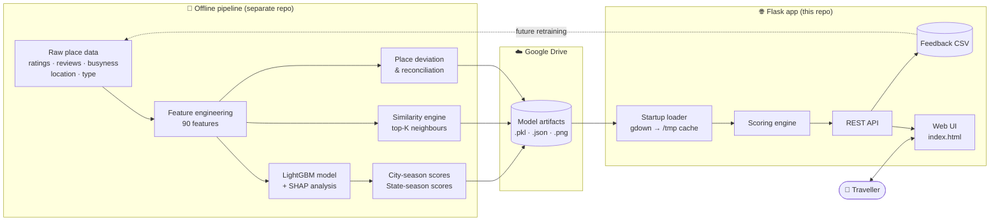
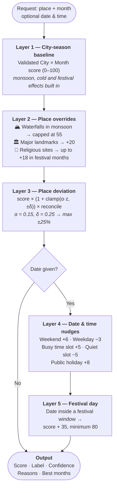
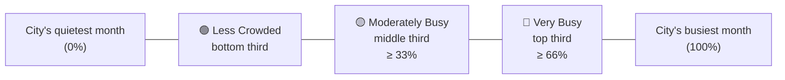
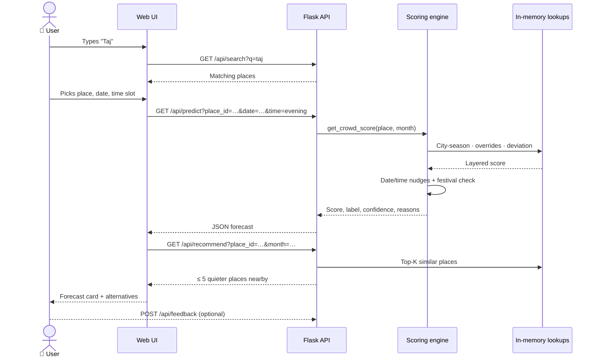
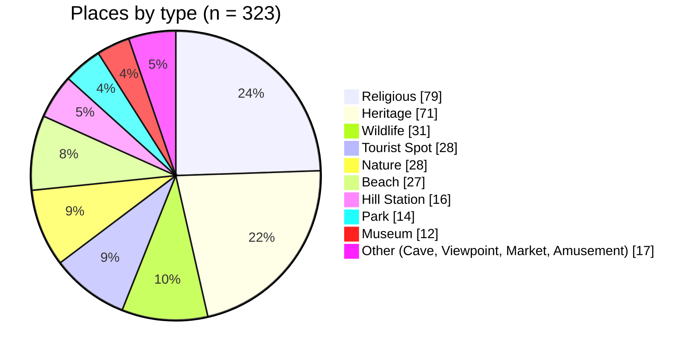
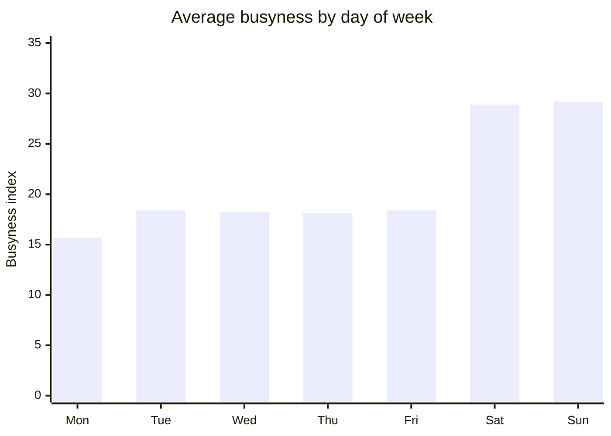
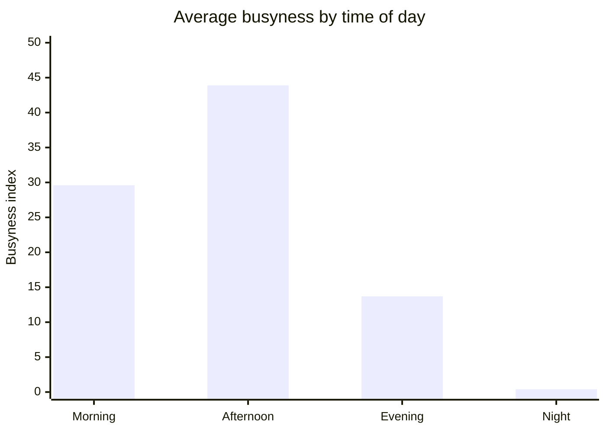
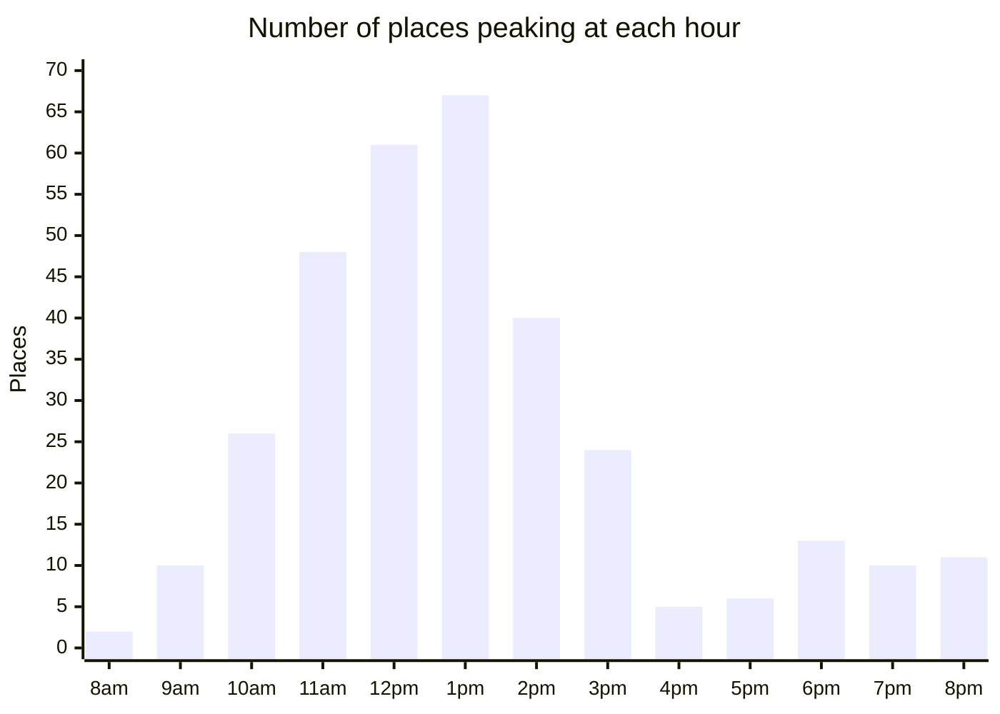
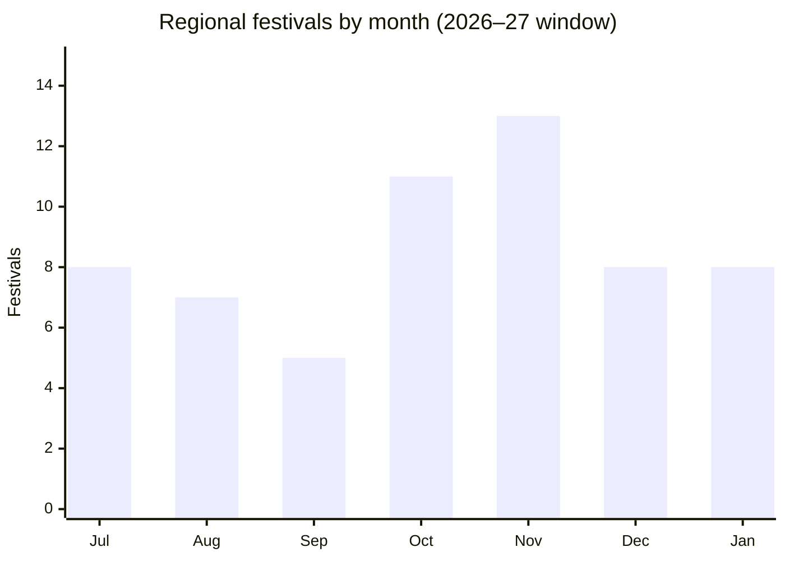

<div align="center">

# 🇮🇳 Crowd Forecast — India Tourism

### Know before you go: crowd forecasting & smart recommendations for Indian tourist places


</div>

---

## 📌 What is this?

Popular Indian destinations swing from empty to packed depending on the **season, festival calendar, day of the week and time of day**. A visit to Puri during Rath Yatra or Delhi on Republic Day is a completely different experience from the same trip a month later.

**Crowd Forecast** answers three questions for a traveller:

| Question | What the app gives you |
|---|---|
| 🔮 *How crowded will it be?* | A **0–100 crowd score** with a 🟢 / 🟡 / 🔴 label, a confidence value and plain-language reasons |
| 📅 *When should I go instead?* | The **3 quietest months** for that city, plus festival and holiday warnings |
| 🧭 *Where else can I go?* | Up to **5 similar places nearby** that are noticeably less crowded |

Forecasts work at three levels: a **single place**, a **whole city**, or an **entire state**.

---

## ✨ Features at a glance

- **Place forecast:** score, label, confidence and up to 4 reasons for any place and month.
- **Date & time refinement:** pick an exact date and a slot (🌅 Morning · ☀️ Afternoon · 🌆 Evening · 🌙 Night).
- **Festival intelligence:** 60 regional festivals with exact 2026–27 date windows, 44 of them verified against the panchang.
- **Less-crowded alternatives:** similarity-based recommendations, filtered by distance (default 200 km).
- **City & state views:** monthly score plus a full 12-month crowd curve.
- **Feedback loop:** users report what they actually saw, building real ground-truth data.
- **Explainability:** a SHAP feature-importance plot from the trained model.

---

## 🏗️ System architecture



**Design choice:** the heavy work (training, seasonal scoring, similarity search) happens **offline**. The web app only loads pre-computed lookups at startup, so every request is answered from in-memory dictionaries and stays fast, even on a single small worker.

---

## 🧠 How a prediction is made

Every forecast is built in **layers**. Each layer makes a small, explainable adjustment to the one before it.



### Layer details

**1. City-season baseline.** The core signal is a pre-computed score for every `City|Month` pair. Seasonal factors (cold-weather closures based on latitude and temperature, heavy-rainfall dampening, park closures during monsoon, regional festival peaks) are derived from features, not hand-written name lists.

**2. Place overrides.** Only a few place-level rules remain:
- Waterfalls are scenic in monsoon but rarely packed, so they're capped at Medium (score ≤ 55).
- Landmarks (100k+ reviews or 250k+ government-counted visitors, 14 verified with ASI data) get +20.
- Religious places get a boost scaled by national festival intensity:

| Month | Jan | Feb | Mar | Apr | May | Jun | Jul | Aug | Sep | Oct | Nov | Dec |
|---|---|---|---|---|---|---|---|---|---|---|---|---|
| Intensity | 0.4 | 0.2 | 0.7 | 0.4 | 0.2 | 0.2 | 0.3 | 0.6 | 0.6 | **1.0** | 0.9 | 0.3 |
| Boost (×18) | +7 | +4 | +13 | +7 | +4 | +4 | +5 | +11 | +11 | **+18** | +16 | +5 |

**3. Place deviation (bounded residual).** Two places in the same city aren't equally busy. Each place has a pre-computed **z-score** (`z`) measuring how much busier or quieter it is than its city, based on popularity, busyness and rating:

```
adjustment = clamp(α · z, −δ, +δ)          α = 0.15, δ = 0.25
place      = city_score × (1 + adjustment) × reconcile_factor(city)
```

The clamp keeps any place within ±25% of its city. The **reconciliation factor** rescales a city's places so their average still matches the validated city score, so place-level tweaks never distort the city-level truth.

**4. Date & time nudges.** These are applied only when the seasonal score is ≥ 12, so a place that's effectively closed isn't "re-opened" by a weekend bump.

**5. Festival day.** If the exact date falls inside a festival window for that city or state (e.g. Rath Yatra, Puri: 16–26 Jul 2026), the score jumps to at least 80.

### 🧮 Worked example (illustrative numbers)

> *A famous heritage landmark in a city whose December baseline is 60. Forecast for a Saturday evening.*

| Step | Calculation | Score |
|---|---|---|
| City baseline (Dec) | — | **60.0** |
| Landmark boost | 60 + 20 | **80.0** |
| Place deviation (z = +1.2) | 80 × (1 + min(0.18, 0.25)) × 0.97 | **91.6** |
| Saturday | + 6 | **97.6** |
| Evening is a quiet slot here | − 5 | **92.6** |
| **Result** | Ranked against the city's yearly range | 🔴 **Very Busy** |

### 🏷️ Labels are *relative*, not absolute

A score of 50 means something very different for Goa than for a quiet hill town. So instead of fixed global cut-offs, each score is **ranked within its own city's 12-month range**:



```
position = (score − city_min) / (city_max − city_min)
```

**Confidence** reflects how strongly the city's seasons differ: `62 + (yearly spread / 100) × 30`, capped at 92%. Cities with sharp peaks and troughs give more confident forecasts than cities that stay flat all year.

---

## 🔄 Request flow

What happens when a user searches for a place and clicks **Predict**:



---

## 📊 What the data shows

These charts come from the sample dataset in this repo (`india_crowd_forecast_final.csv`: **323 places · 213 cities · 33 states · 90 features**).

### Place types in the sample



### Weekends roughly double the crowd

Average busyness index across all places, by day of the week:



### Afternoons are the peak

Average busyness by time slot, plus the hour each place hits its peak:





Most places peak between **11 am and 2 pm**. A smaller second bump at **6–8 pm** comes from evening spots like beaches and markets.

### Indoor & cultural sites are busiest on average

| Place type | Avg busyness | | Place type | Avg busyness |
|---|---|---|---|---|
| 🏛️ Museum | **53.9** | | ⛰️ Hill Station | 37.2 |
| 🙏 Religious | 50.3 | | 🏖️ Beach | 37.2 |
| 🏛️ Heritage | 50.2 | | 🌳 Park | 32.8 |
| 🪨 Cave | 44.5 | | 🎡 Amusement Park | 31.9 |

### Festival season = Oct–Jan

The embedded festival table (60 festivals: 40 city-level, 20 state-level) is concentrated in the post-monsoon and winter months:



Each festival has a **magnitude** (1 = local, 2 = regional, 3 = major: 30 of the 60) and one or more exact date windows.

---

## 🧬 Feature set

The 90 columns in the dataset fall into these groups:

| Group | Example columns | Purpose |
|---|---|---|
| **Identity & location** | `place_name`, `city`, `state`, `zone`, `latitude`, `longitude` | Grouping, distance, regional effects |
| **Place profile** | `place_type`, `significance`, `est_year`, `age_years`, `entry_fee_inr`, `time_needed_hrs`, `weekly_off`, `dslr_allowed` | What kind of place it is |
| **Popularity** | `rating`, `num_reviews`, `popularity_score` | How well known it is |
| **Crowd statistics** | `crowd_mean/max/min/median/std`, `weekend_crowd`, `festival_crowd`, `weekend_lift` | Historical crowd levels |
| **Busyness by time** | `morning_avg`, `afternoon_avg`, `evening_avg`, `night_avg`, `peak_hour` | Time-of-day refinement |
| **Busyness by day** | `mon_avg` … `sun_avg`, `peak_day`, `weekend_premium` | Day-of-week refinement |
| **Seasonality** | `best_time`, `best_winter/summer/monsoon/all_year` | When to visit |
| **One-hot types** | `is_museum`, `is_religious`, `is_beach`, … | Model inputs |
| **Normalised** | `*_norm` columns | Similarity search |
| **Target** | `crowd_level_final`, `crowd_label_final` | Low / Medium / High (balanced: 111 / 102 / 110) |

> ℹ️ The `pt_source` column records where the busyness data came from: **54 places use real data, 269 use synthetic estimates**.

---

## 🛠️ Tech stack

| Layer | Tools |
|---|---|
| **Backend** | Python 3.11 · Flask 3 · Gunicorn |
| **ML & data** | LightGBM · scikit-learn · NumPy · pandas · SHAP (offline) |
| **Frontend** | Vanilla HTML / CSS / JS · Inter font |
| **Model hosting** | Google Drive, fetched with `gdown` |
| **Deployment** | Render (`Procfile` + `runtime.txt`) |

---

## 📁 Project structure

```
crowd-forecasting/
├── app.py                          # Flask app — artifact loading, scoring engine, API
├── templates/
│   └── index.html                  # Single-page UI (search, forecast card, alternatives)
├── india_crowd_forecast_final.csv  # Sample dataset — 323 places × 90 features
├── requirements.txt                # Python dependencies
├── runtime.txt                     # python-3.11.7
└── Procfile                        # Gunicorn start command
```

### Model artifacts (auto-downloaded)

Large files aren't committed to git. On first start they're downloaded from Google Drive into `/tmp/crowd_cache` and reused after that.

| File | Contents | Required? |
|---|---|---|
| `recommendation_engine_final.pkl` | Place info, top-K similar places, coordinates | ✅ Yes |
| `city_season_scores.json` | `City\|Month → score` | ✅ Yes |
| `time_of_day_lookup.json` | Hourly & daily busyness per place | ✅ Yes |
| `state_season_scores.json` | `State\|Month → score` | Optional: state view disabled without it |
| `place_overrides.json` | Waterfall, landmark and religious tags | Optional |
| `place_deviation.json` · `city_reconcile.json` · `deviation_config.json` | Layer 3 inputs (z-scores, factors, α/δ) | Optional: places fall back to city score |
| `shap_summary_bar.png` | Feature-importance plot | Optional |

The app **degrades gracefully**: if an optional file fails to load, that feature is switched off and everything else keeps working.

---

## 🚀 Getting started

### Prerequisites
- Python **3.11+**
- Internet access on the first run (to download model artifacts)

### Run locally

```bash
# 1. Clone
git clone https://github.com/evynxprojects-intern/crowd-forecasting.git
cd crowd-forecasting

# 2. Create a virtual environment
python -m venv venv
source venv/bin/activate          # Windows: venv\Scripts\activate

# 3. Install dependencies
pip install -r requirements.txt

# 4. Start the app
python app.py
```

Open **http://localhost:5000** 🎉

> ⏳ The first launch takes longer while artifacts download. Later starts use the cache.

### Production (Gunicorn)

```bash
gunicorn app:app --bind 0.0.0.0:5000 --timeout 120 --workers 1
```

A single worker is used because all lookups are held in memory. The 120 s timeout covers the first-run download.

### Deploy to Render

1. **New → Web Service** → connect this repo
2. **Build command:** `pip install -r requirements.txt`
3. **Start command:** read automatically from the `Procfile`
4. Render injects `PORT`; no other configuration is needed

---

## 🔌 API reference

| Method | Endpoint | Description |
|---|---|---|
| `GET` | `/` | Web UI |
| `GET` | `/api/search?q=taj&limit=10` | Search places by name / city / state |
| `GET` | `/api/search_region?q=jai&level=city` | Type-ahead for cities or states (`level=state`) |
| `GET` | `/api/popular` | Featured places for the home screen |
| `GET` | `/api/predict` | **Place forecast** (see below) |
| `GET` | `/api/recommend?place_id=…&month=12&max_dist=200` | ≤ 5 quieter similar places nearby |
| `GET` | `/api/city_predict?city=Jaipur&month=12` | City score + 12-month curve |
| `GET` | `/api/state_predict?state=Rajasthan&month=12` | State score + 12-month curve |
| `GET` | `/api/states` | All states with data |
| `GET` | `/api/festivals?city=Puri&month=7` | Regional festivals (filterable) |
| `GET` | `/api/shap` | SHAP feature-importance image |
| `POST` | `/api/feedback` | Submit an observed crowd level |
| `GET` | `/api/feedback/export` | Download all feedback as CSV |
| `GET` | `/api/health` | Health check & loaded-data counts |

<details>
<summary><b>📄 <code>/api/predict</code>: parameters & response</b></summary>

**Parameters**

| Name | Required | Default | Notes |
|---|---|---|---|
| `place_id` | ✅ | — | e.g. `IND_000` |
| `date` | — | — | `YYYY-MM-DD`; enables date/time/festival refinement |
| `time` | — | `afternoon` | `morning` · `afternoon` · `evening` · `night` |
| `month` | — | `10` | Used when no `date` is given |

**Response** (illustrative values)

```json
{
  "place_id": "IND_000",
  "place_name": "India Gate",
  "city": "Delhi",
  "state": "Delhi",
  "place_type": "Heritage",
  "emoji": "🏛️",
  "date": "2026-12-26",
  "month_name": "December",
  "score": 82.4,
  "label": "High",
  "label_text": "Very Busy",
  "confidence": 84,
  "color": "#EF4444",
  "icon": "🔴",
  "reasons": [
    "Peak winter tourist season",
    "Pleasant weather attracting visitors",
    "High search interest this month",
    "Saturday — weekend crowds expected"
  ],
  "month_tip": { "months": [6, 7, 8], "text": "Visit in Jun, Jul, Aug for a quieter experience" },
  "day_name": "Saturday",
  "time_label": "Evening (5pm-9pm)",
  "is_weekend": true,
  "lat": 28.6139,
  "lon": 77.209
}
```
</details>

<details>
<summary><b>📝 <code>/api/feedback</code>: example</b></summary>

```bash
curl -X POST http://localhost:5000/api/feedback \
  -H "Content-Type: application/json" \
  -d '{
        "place_id": "IND_000",
        "user_label": "High",
        "month": 12,
        "predicted_score": 82.4,
        "predicted_label": "High"
      }'
```

`user_label` must be `Low`, `Medium` or `High`. Each row is stored with a UTC timestamp so predictions can later be compared against what users actually saw.
</details>

---

## ⚠️ Limitations & notes

| Area | Note |
|---|---|
| 🗃️ **Feedback storage** | Saved to `/tmp/crowd_feedback.csv`, which is **wiped on every Render restart**. Export it regularly via `/api/feedback/export`. |
| 📅 **Festival dates** | Lunar-calendar dates are set for **Jul 2026 – Jan 2027**. Update `REGIONAL_FESTIVALS` in `app.py` each year (no model rebuild needed). |
| 🎌 **Public holidays** | Fixed-date table in `app.py`; movable holidays need manual updates. |
| 🧪 **Data quality** | Most busyness data in the sample is synthetic, so treat forecasts as **guidance, not guarantees**. |
| 🏭 **Training code** | This repo only serves the model. Training and score generation live in a separate offline pipeline. |

---

## 🗺️ Roadmap

- [ ] Persist feedback in a database instead of `/tmp`
- [ ] Use collected feedback to calibrate and retrain scores
- [ ] Automate the yearly festival-calendar refresh
- [ ] Interactive map view for alternatives
- [ ] Add the 12-month crowd curve chart to the city and state views

---

## 🤝 Contributing

1. Fork the repository
2. Create a branch: `git checkout -b feature/your-feature`
3. Commit: `git commit -m "Add your feature"`
4. Push: `git push origin feature/your-feature`
5. Open a Pull Request

---

## 📄 License

No license has been chosen yet. Add a `LICENSE` file (e.g. MIT) to let others use and build on this project.

<div align="center">

**Made with ❤️ for smarter, calmer travel across India**

</div>
